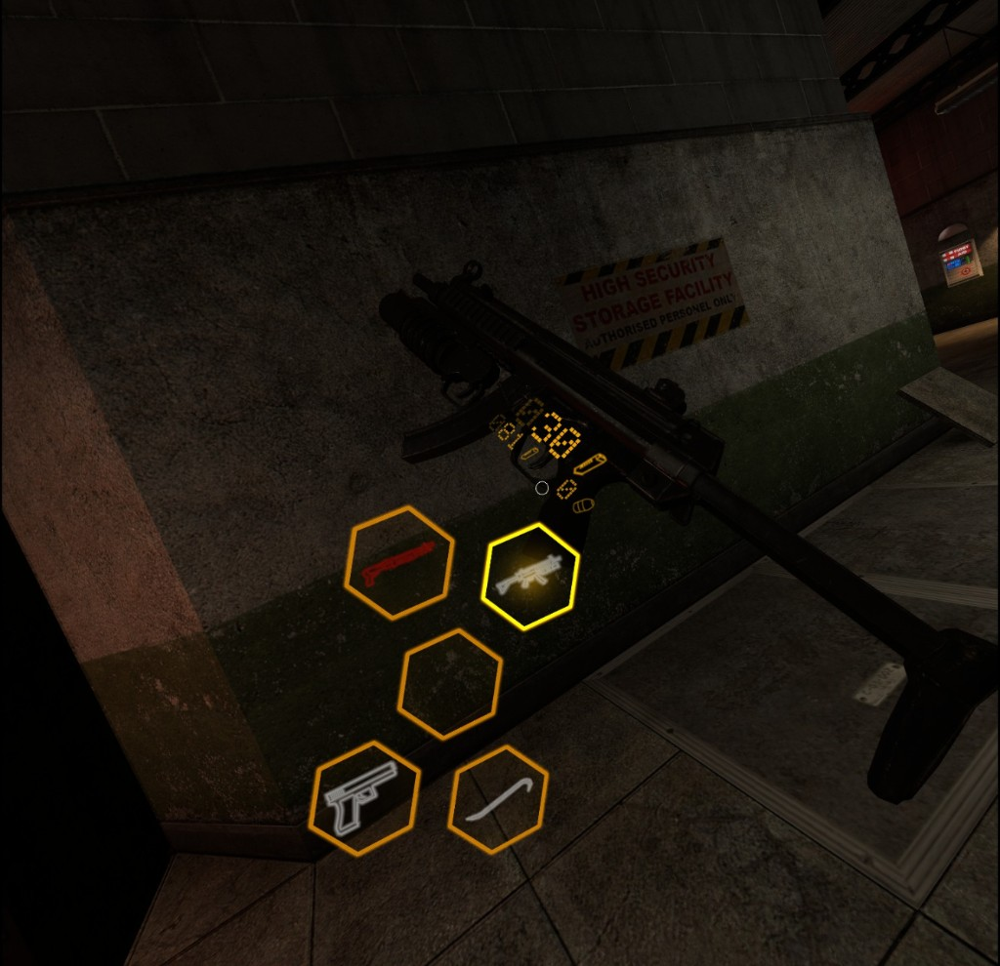
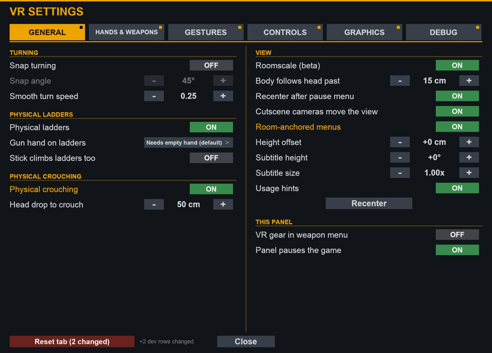
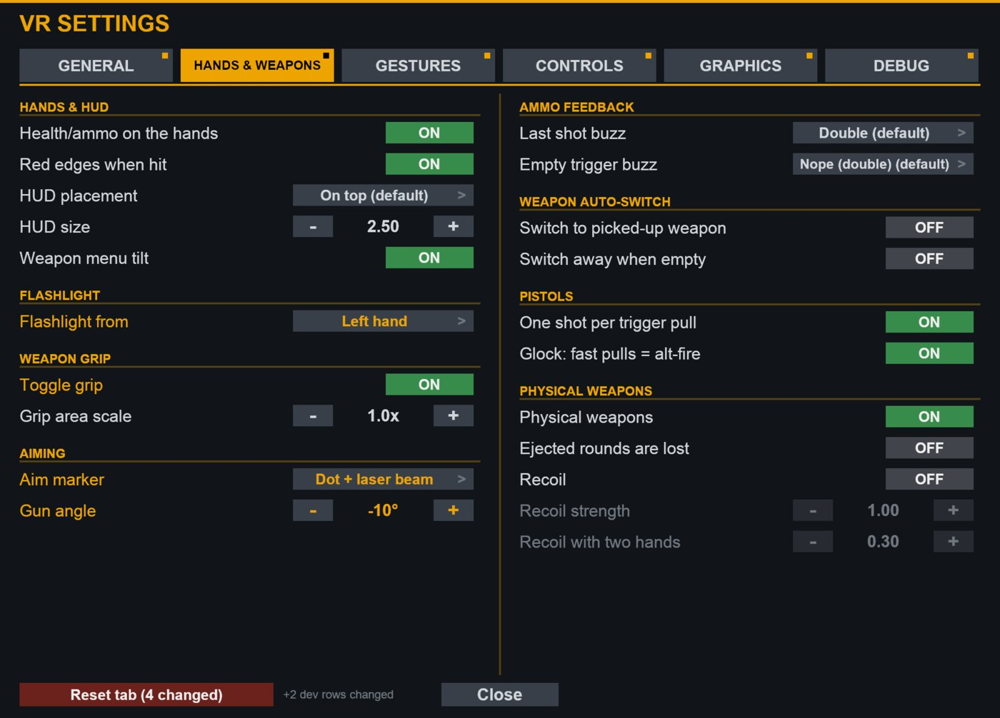
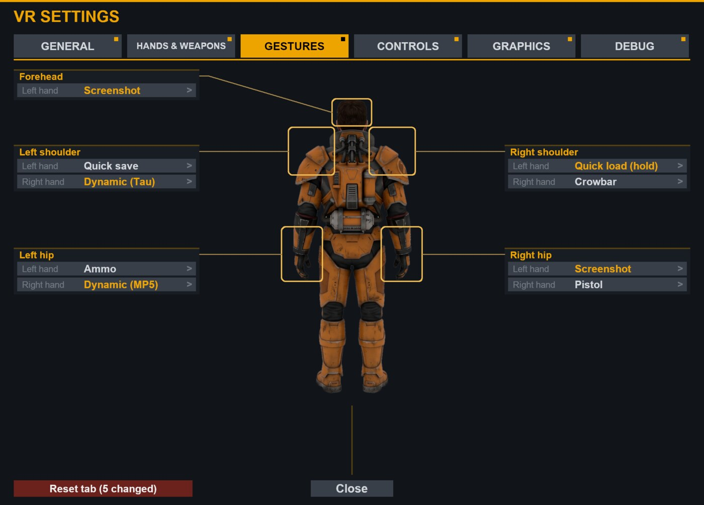
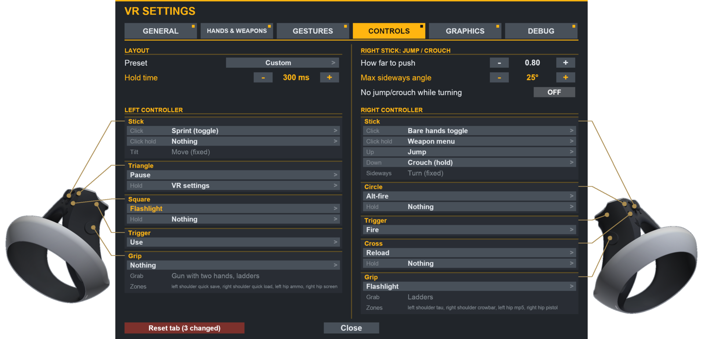
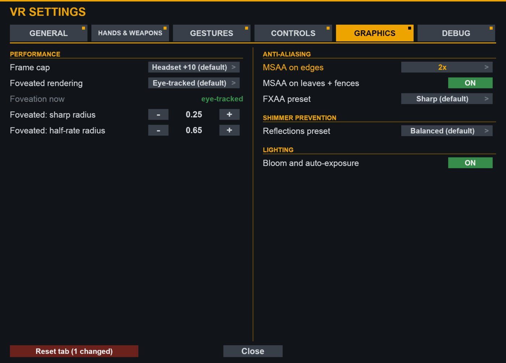

# Black Mesa VR

<a href="https://www.youtube.com/watch?v=S9kmK95yqgM">
  
</a>

[](https://ko-fi.com/P5P56X4HH)

A VR mod for the Steam version of **Black Mesa**: true stereo rendering, 6DOF motion controls, OpenXR, and
weapon handling built for VR. The whole campaign is playable from start to finish, and **Black Mesa: Blue Shift**
works too.

The VR foundation is based on the approach pioneered by **[L4D2VR](https://github.com/keyou91/l4d2vr)**, adapted and
extended for Black Mesa, with weapon selection, crowbar swinging and more adapted from **HL2VR**.

A macOS version lives here: https://github.com/armax9/black-mesa-vr-macos

**Download:** [Releases page](https://github.com/Hochgeschwindigkeitsrennfahrer/black-mesa-vr/releases): get the latest release.

## Features

### Playing
- **6DOF motion controls**, the gun follows your hand, and you aim with the controller while you walk where you look.
- **Two-handed weapons:** put your off-hand on the forend of a rifle, shotgun, MP5, crossbow and so on and hold grip;
  the glove sits on the gun and steadies it. Hands & Weapons tab, Weapon grip: **Toggle grip** (squeeze once to hold,
  again to let go) and **Grip area scale** (a bigger zone if the gun is hard to take).
- **Manual reloads:** pull the magazine, take a new one from your hip and seat it, rack the slide or bolt, load
  shotgun shells one by one. On by default; Hands & Weapons > Physical weapons off = reload with a button.
- **Grab gestures:** a hand behind a shoulder, at a hip or (left hand) at the forehead + grip. Each zone has a setting
  per hand: the right hand draws a weapon (default: right shoulder crowbar, right hip pistol, above the left hip MP5;
  "Dynamic" zones keep what you put away there), the left hand does an action (quick save, flashlight, ammo, quick
  load, screenshot into the Steam library, recenter; default: left shoulder quick save, left hip ammo, forehead flashlight).
- **Crowbar swinging** that hits where you swing (HL2VR style).
- **HL2VR-style weapon wheel** (the VR settings gear below the crowbar is optional, General > This panel).
- **Grenades thrown at the speed of your hand.**
- **Crossbow scope built for VR:** bring the crossbow to your face with both hands to zoom; the zoomed view follows the
  crossbow, with smoothing for hand tremor.
- **Mounted guns** (50 cal, TOW) you steer with your hands.
- **Ladders that work in VR:** push the stick roughly towards a ladder to get on, also while swimming; no need to
  face it exactly as the game normally wants. With **Physical ladders** (General tab, on by default) you climb hand
  over hand by the rungs.
- **Per-hand item holding and use.**
- **Gun, hands, HUD and laser locked together:** all drawn from one tracking sample for both eyes, so nothing jitters
  or lags behind in heavy scenes or fast moves.
- **Health, suit and ammo on your hands**, an ammo counter on the weapon, and a **short red flash over the view when
  you get hit**.
- **Usage hints:** short messages the first times you carry a prop or take a mounted gun, naming your own alt-fire
  button, and when a reload step is missing ("PUMP IT"). General tab > Usage hints.
- **Aim marker and laser:** one preset: off, a red dot only on guns without sights (tau, gluon, crossbow), a red dot (default), or a red dot with a laser beam.
- **Flashlight** on the right grip, optionally in the left hand or on the left Square/X button.
- Snap or smooth turning, crouch while held or toggle, sprint toggle, recenter. Cutscene cameras can take your view
  with them as the scene was made; turn that off if it is too much for your VR legs.
- **Physical crouching** (optional, General tab): crouch in real life to crouch in the game.
- **Roomscale (beta, on by default):** walk around your play space and your body follows your head, also on trains
  and trams. General > View.
- **Subtitles / closed captions** below your view when they are on in the game's audio options; height and size in
  General > View.
- **Bare hands until you get the HEV suit** (and throughout Blue Shift), HEV gloves after that.
- **VR main menu and pause menu** in the world, with a motion-controller pointer, and Black Mesa's loading screens
  as a flat panel.

### Image quality and performance
- **True stereo rendering** with each eye's own field of view, so no pixels are wasted outside the lenses, at the
  headset's full resolution or above it.
- **Foveated rendering:** the edges of each eye are shaded at a lower rate, which you hardly notice in the headset
  but gives a large speed-up in heavy scenes. **Eye-tracked** on headsets with eye tracking (the sharp area follows
  where you look), fixed at the lens centre on headsets without it. On by default.
- **MSAA on the eyes** (2x / 4x): much smoother edges on walls, pipes, cables, models and the gun, optionally also on
  leaves and fences.
- **FXAA tuned for VR**, with Sharp / Balanced / Smooth presets.
- **Less shimmer:** calmer cubemap reflections on shiny walls and floors (Full / Balanced / Subtle), lens flares,
  light glows and smoke that stay level and agree between the eyes.
- **God rays made for VR:** the blur runs at quarter size (blur 0.80 -> 0.17 ms per frame, same look), and the shafts
  stay steady when you look up or down.
- **MulticoreMode:** the game's render thread runs next to the game, and heavy outdoor areas keep a much higher
  frame rate than before.
- Many fixes for things that only break in VR: water and mirror reflections per eye, objects popping in one eye,
  glows shining through walls, Xen fog, and more.

### The VR settings panel
**Hold Triangle/Y** (about half a second) or click **VR SETTINGS** on the pause menu. Six tabs:
- **General:** turning, ladders, view, usage hints, menus.

  

- **Hands & Weapons:** hand HUD and its position, flashlight, aim marker and laser,
  ammo feedback, weapon auto-switch, pistols, physical weapons.

  

- **Gestures:** what each hand does in each grab zone, on a picture of the HEV suit. A zone lights up while your hand
  is in it.

  

- **Controls:** every button of both controllers, shown on pictures of your own controllers (PS VR2 Sense, Quest
  Touch, Index, WMR / Reverb G2, Steam Frame). Pick a preset or set each press and hold yourself.

  

- **Graphics:** foveated rendering, frame cap, MSAA, FXAA, reflections, bloom.

  

- **Debug:** diagnostics, logs and debug captures for bug reports.

Most changes apply right away. Settings you changed show in amber (the screenshots show a player's own setup). The panel only saves those into `VR\config.txt`, so improved
defaults reach you with each update.

## Install

### What you need
- **Black Mesa on Steam**, up to date on the default branch (no beta). On **Linux** use the **Proton** version
  of the game (Properties → Compatibility), not a native build.
- A PC VR headset with an **OpenXR runtime**: SteamVR, Meta Link, Virtual Desktop (VDXR), WMR and others.

### Steps
1. **Quit Black Mesa.** A running game does not pick up the new files.
2. Download the zip from the [Releases page](https://github.com/Hochgeschwindigkeitsrennfahrer/black-mesa-vr/releases)
   and extract it.
3. Copy **everything inside** `drop-into-Black-Mesa-folder` into your Black Mesa folder, the one that contains
   `bms.exe` (Steam → Black Mesa → Manage → Browse local files). Replace files when asked.
   This puts `d3d9.dll` in all three places it has to be: the game folder, `bin\` and `bin\thirdparty\dxvk-windows-x86\`.
4. **Steam → Black Mesa → Properties → Launch Options:**
   ```text
   -heapsize 524288 -processheap -high -novid -windowed -oldgameui
   ```
   `-oldgameui` is required (the new game UI is upside-down in the headset). If the game's video menu shows
   **Direct3D 9** as the renderer, also add `-enabledxvk`.
5. **Turn off Steam Input for Black Mesa** (Properties → Controller → Disable Steam Input).
6. Pick **one OpenXR runtime** and start it before the game:
   - **SteamVR:** SteamVR → Settings → OpenXR → Set SteamVR as OpenXR runtime.
   - **Meta Link (Quest):** uses the Link / Oculus OpenXR runtime.
   - **Virtual Desktop:** Streamer → Options → **OpenXR Runtime = VDXR**. "SteamVR" in that dropdown shows the
     world upside-down.
7. Launch Black Mesa from Steam. `bmvr_log.txt` next to `bms.exe` should appear and start with `BMVR d3d9.dll loaded`.

**Updating:** copy the new zip over the old install the same way. The zip has no `VR\config.txt`, so your settings
are kept: that file holds only what you changed. Installs from before 2026-11-26 get it cleaned up once on the first
start (old shipped defaults and comments removed, your own changes kept, the old file saved as `VR\config.txt.bak`).

**Uninstall:** quit the game, then in the Black Mesa folder delete `d3d9.dll`, `BMVR_README.txt`, `bmvr_*` files,
the `VR\` folder, `bin\d3d9.dll`, `bms\cfg\bmvr.cfg` and `bms\sound\bmvr\` (same under `bshift\` if you played Blue
Shift). Installs from before 2026-11 may also have `openvr_api.dll` next to `bms.exe`,
`bin\thirdparty\dxvk-windows-x86\openvr_api.dll` and `bin\sourcevr.dll.disabled`: delete those too. Then run Steam → Black Mesa → Properties → Installed Files → **Verify integrity of game files**:
it restores the game's own `d3d9.dll` in the DXVK folder, `bin\openvr_api.dll` and `bin\sourcevr.dll`. Verify alone
is not enough: it does not delete the mod's extra files. Remove the launch options too.

**Blue Shift:** same install, plus `-game bshift` in the launch options. Calhoun
keeps bare hands for the whole campaign, and the weapon wheel and wrist HUD turn security-guard blue.

## Recommended setup

### In the VR settings panel (Graphics tab)
- **Foveated rendering: Eye-tracked** (default). The "Foveation now" row shows what it is actually doing: eye-tracked,
  fixed, or off because your GPU has no variable-rate shading. Without eye tracking it falls back to the lens centre
  by itself. Turning it on from off needs a game restart; the row tells you.
- **MSAA: 2x** if your GPU has room. It costs about 2 ms per frame in a heavy room on an RX 9070; 4x roughly
  doubles that. Keep **"MSAA on leaves + fences"** and **"MSAA skips particles"** on.
- **Keep FXAA on next to MSAA.** MSAA smooths geometry edges; it cannot reach Black Mesa's lighting, so thin lit
  objects (railings) and specular sparkle need FXAA. Start with the **Sharp** preset.
- **Reflections (shimmer): Balanced** (default). **Subtle** if shiny floors still shimmer, **Full** for the game's
  original look.

### In Black Mesa's video options
- **Anti-aliasing: FXAA** (the mod tunes it for the headset).
- Lower shadow and light quality first if you run short on frame rate; those cost more in VR than in flat play.

### In `VR\config.txt` (not in the panel)
A few settings can only be changed in this file, because they set up the eye images when the game starts.
**Quit the game fully before you edit it**; it is read once at launch. No `VR\config.txt` yet: create it (plain
text, one `Key=value` per line).

| Setting | Default | What it does |
|---|---|---|
| `RenderScale` | `1.0` | Multiplier on the headset's recommended eye size. **Above 1.0 = supersampling: sharper and much less shimmer**, at a GPU cost (1.2 renders about 44 % more pixels). If your PC can handle it, **1.2–1.4 is the biggest single image upgrade**; foveated rendering makes this a lot more affordable. Below 1.0 (0.8–0.9) if you are GPU-bound. |
| `OpenXRHelperDownsample` | empty | `box`: with RenderScale above 1.0, the mod scales the big eye image down to the headset size itself, for cleaner edges. Try it together with a higher RenderScale. |
| `MaxEyeSize` | `4096` | Largest eye side in pixels. Raise it (up to 5456 with MulticoreMode) only if a high RenderScale hits the cap; `bmvr_log.txt` shows the eye size that was used. Far above 4096 can run the 32-bit game out of memory. |
| `ReflectionRtScale` | `0.5` | Resolution of **water and mirror-floor reflections**, as a fraction of the eye size. Higher = sharper reflections and less shimmer at floor and wall edges, but costs GPU in rooms with big reflective floors. `0` = the game's fixed 1024×1024, which shimmers badly at headset resolution. |
| `RefractCopyRtScale` | `0.5` | Resolution of the screen copy that **shiny floors and wired glass** sample. At the game's 1024×1024 the edges where floors meet walls look jagged. It is only a copy, so it is cheap: leave it at 0.5. |
| `OffCenterEyes` | `true` | Renders each eye's own field of view instead of one wide view for both eyes. Most headsets see further outward than inward, so this is sharper at the same cost. Set to `false` only if the view looks wrong on your headset. |
| `DesktopEye` | `right` | Which eye the desktop window (and stream/recording) shows: `right` or `left`. |
| `IPDScale` | `1.0` | Stereo depth strength (0.8–1.2): multiplies the eye separation your headset reports. Higher = more depth and a smaller-feeling world. Leave it at 1.0; it does not change movement or hand scale, and it is not the place to fix your headset's IPD. |
| `HeightOffset` | `0.0` | Player height in cm (+ = taller; also in the VR panel, General > View). |

`VR\config.example.txt` lists these and more settings with explanations; it is never read itself.

## Known issues
- **Thin lit objects stay jagged even with MSAA 4x** (railings, thin bars). Black Mesa lights the scene in a separate
  pass at 1x that MSAA cannot reach. FXAA softens it.
- **Odd reflections in door glass and windows** look like Black Mesa's own bugs, not the mod's.
- **Very heavy outdoor views can still drop below the headset's refresh rate:** the game draws every eye separately,
  and its render thread is the limit there.
- **Your hands disappear below the water surface** when you reach into water.
- **Switching to an addon from the game's new menu (Blue Shift, Military, ...) does not work in VR:** the game
  restarts its engine in place, the menu then runs at a few fps and starting a game crashes. Start the addon directly
  instead, e.g. with the Steam launch option `-game bshift`.
- The first launch after an update recompiles shaders: expect some hitches in the first minutes.

**Reporting a bug:** attach `bmvr_log.txt` (next to `bms.exe`). For visual problems, **Debug → Capture debug frame**
while the problem is visible helps a lot.

## Credits

**Developers:** [Hochgeschwindigkeitsrennfahrer](https://github.com/Hochgeschwindigkeitsrennfahrer) (original author)
and [marnovdm](https://github.com/marnovdm).

Huge thanks to:
- **wormslayer** for HL2VR.
- **keyou91** for [L4D2VR](https://github.com/keyou91/l4d2vr), the foundation of the VR implementation.
- **martysl1** (Discord), whose AA4 experiment showed that multisampling only the eye images works with Black Mesa's
  deferred renderer; that idea is the basis of the MSAA feature.
- Our testers and contributors, for their patience and help:
  - TheRealBubble
  - SilentVortiguant ([check out his YouTube](https://www.youtube.com/@SilentVortigauntVR))
  - yakupagagaming

Custom models:
- [HEV gloves](https://steamcommunity.com/sharedfiles/filedetails/?id=2969302231)

## Disclaimer

This is an **unofficial, free fan project** and is not affiliated with, endorsed by,
or supported by Crowbar Collective or Valve Corporation.

- **You need a legitimate copy of Black Mesa** (e.g. on Steam) to use this mod.
- This mod does **not** include or distribute any Black Mesa or Valve game files, code, or assets.
- This mod is **not sold** and never will be. It's made purely for the love of the game.
- Please don't report problems with this mod to Crowbar Collective or Valve.
  Use our [issue tracker](https://github.com/Hochgeschwindigkeitsrennfahrer/black-mesa-vr/issues) instead.

Black Mesa is a trademark of Crowbar Collective. Half-Life is a trademark of Valve Corporation.
